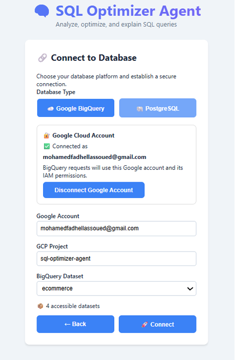
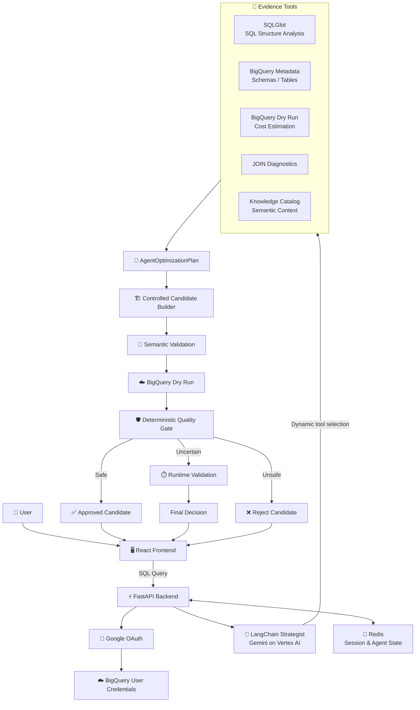
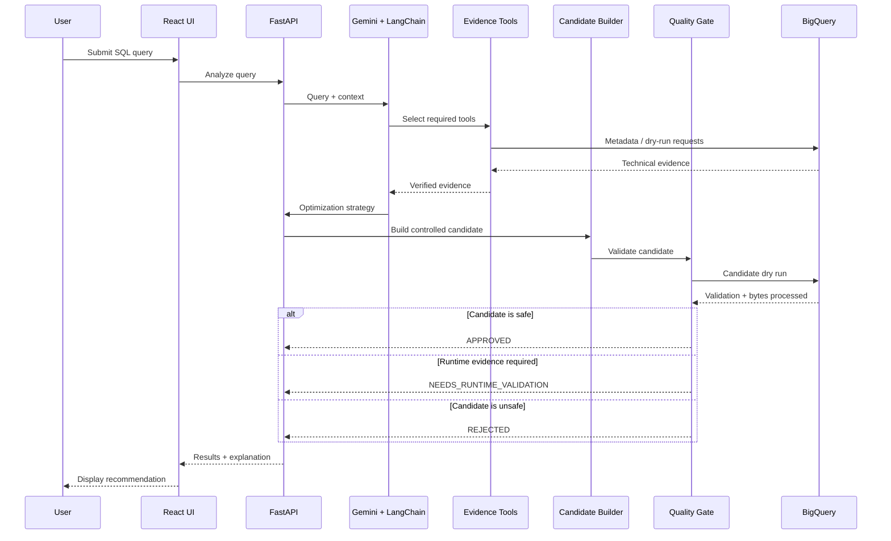
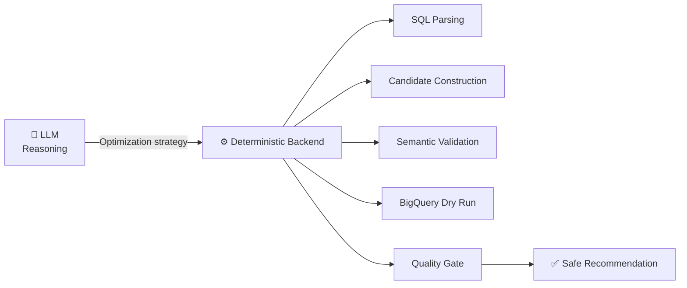
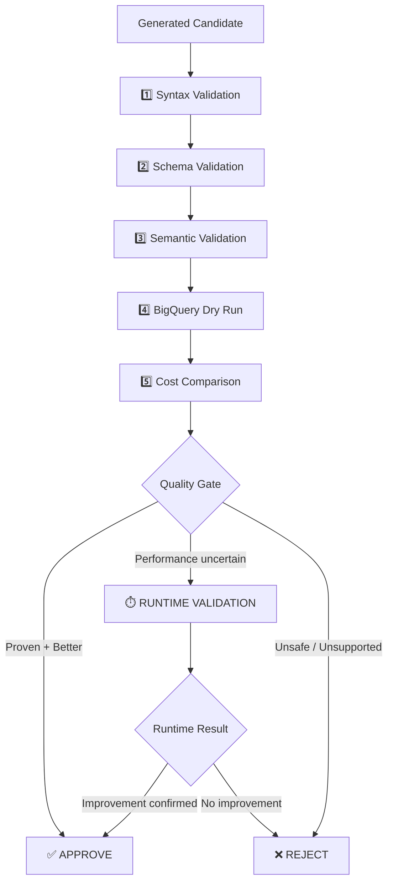
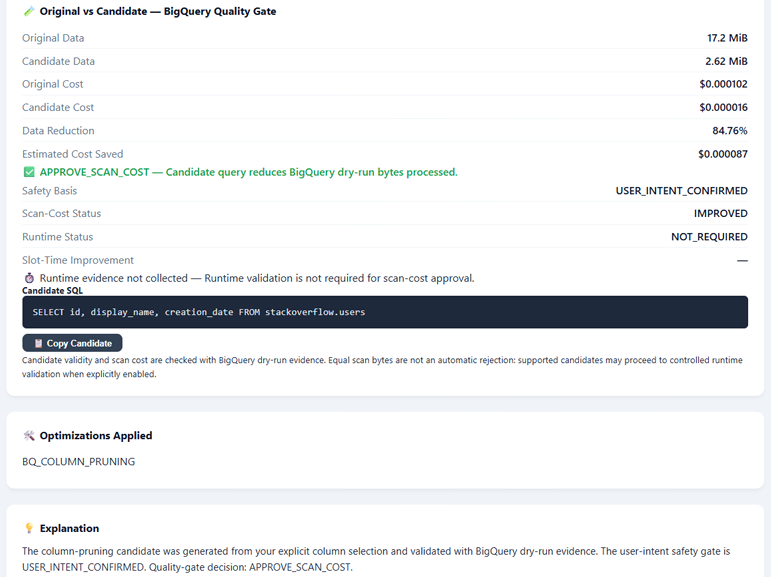
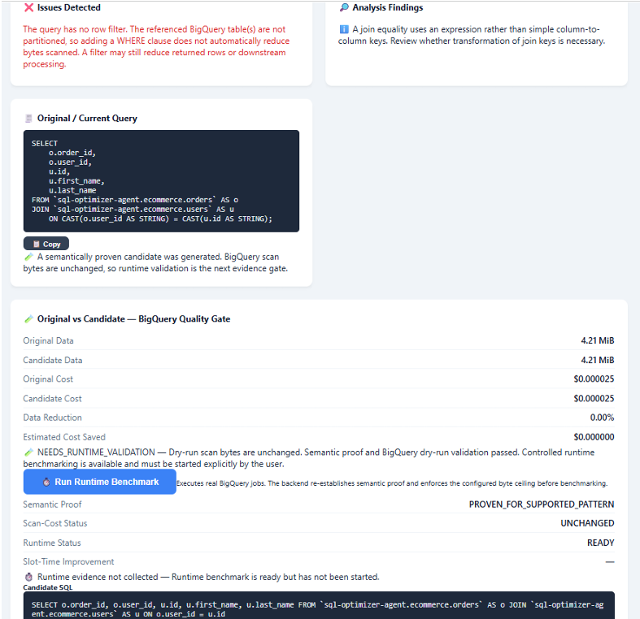
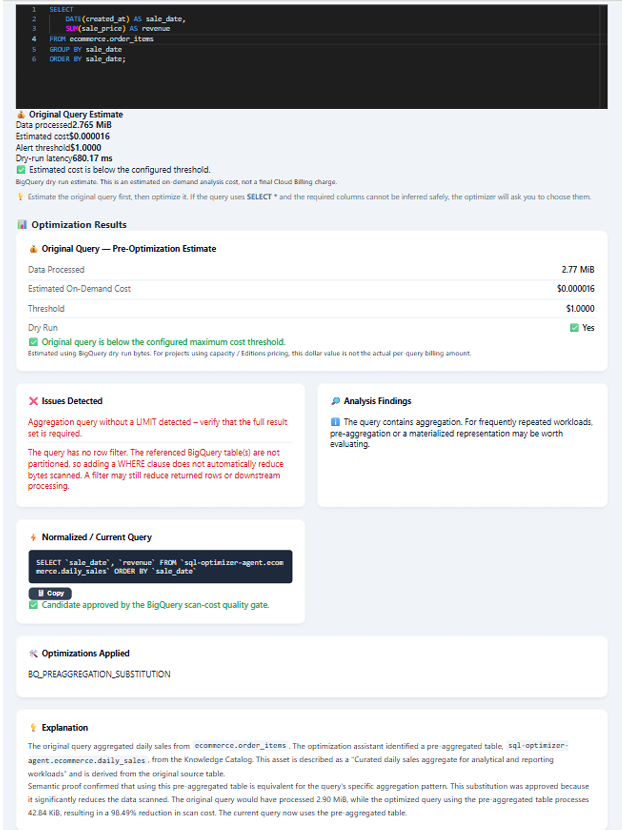
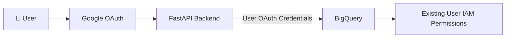

# 🤖 Agentic SQL Optimizer for Google BigQuery

> An agentic AI system for SQL query optimization and BigQuery cost management, combining LLM-based reasoning with deterministic validation and evidence-driven optimization.

<p align="center">
  
  
  
  
  
  
  
  
</p>

---

## 📌 Overview

This project is an **agentic AI assistant for SQL optimization and BigQuery cost management**.

The system analyzes SQL queries before execution, gathers technical, semantic, and cost-related evidence, identifies optimization opportunities, and proposes optimized SQL candidates.

Unlike a traditional LLM-based SQL assistant, the system does **not allow the language model to directly approve or execute arbitrary SQL rewrites**.

Instead, it follows a hybrid architecture where:

- **Gemini on Vertex AI + LangChain** handle reasoning, dynamic tool selection, and optimization strategy.
- **SQLGlot** performs deterministic SQL parsing and structural analysis.
- **BigQuery metadata and dry runs** provide authoritative technical and cost evidence.
- **Knowledge Catalog** provides semantic and contextual information about data assets.
- **Controlled candidate builders** generate only supported SQL transformations.
- **A deterministic Quality Gate** validates candidates before they are recommended.
- **Redis** stores session, conversation, intent, candidate, agent, and metadata state.
- **FastAPI + WebSockets** provide the backend and real-time communication layer.
- **React** provides the interactive user interface.

The goal is to preserve the flexibility of an AI agent while ensuring that optimization decisions remain **controlled, explainable, and verifiable**.

---

## 🖥️ Application Preview

<p align="center">
  
</p>

The interface allows authenticated users to connect to BigQuery, select a project and dataset, submit SQL queries, review detected issues, inspect estimated cost, and evaluate validated optimization candidates.

---

## 🎯 Problem

SQL queries executed on cloud data warehouses such as BigQuery can become expensive because of:

- unnecessary full-column scans,
- inefficient JOIN strategies,
- transformed JOIN keys,
- accidental CROSS JOINs,
- repeated aggregations,
- lack of partition-aware access,
- and failure to reuse existing pre-aggregated datasets.

Traditional rule-based analyzers can detect some of these patterns, but they often lack contextual reasoning.

Pure LLM-based systems provide more flexibility, but may generate invalid, unsupported, or semantically unsafe SQL transformations.

This project combines both approaches.

> **The AI reasons about what should be investigated, while deterministic components decide what is safe to recommend.**

---

## ✨ Main Features

- 🤖 Agentic SQL analysis using **Gemini on Vertex AI**
- 🧠 Dynamic evidence-tool orchestration with **LangChain**
- 🔍 SQL parsing and structural analysis using **SQLGlot**
- ☁️ Native **BigQuery** integration
- 💰 BigQuery dry-run cost estimation
- ⭐ `SELECT *` optimization with explicit user intent
- 🔗 JOIN diagnostics
- ⚠️ CROSS JOIN detection
- 🔄 Transformed JOIN-key analysis
- 📊 Large-table JOIN detection
- 📚 Pre-aggregation discovery with **Knowledge Catalog**
- 🧠 Semantic validation for supported transformations
- ✅ Deterministic Quality Gate
- ⏱️ Optional runtime benchmarking
- 🔐 Google OAuth authentication
- 🛡️ Preservation of existing user BigQuery IAM permissions
- 💾 Redis-backed state management
- ⚡ Real-time analysis using WebSockets
- 🖥️ React-based interactive frontend

---

# 🏗️ Architecture

The system follows a **hybrid agentic architecture**.



---

## 🧠 Agentic Workflow

The LLM acts as a **strategist**, not as an unrestricted SQL generator.



---

## 🧩 Why a Hybrid Architecture?

The language model is useful for:

- understanding SQL intent,
- deciding which evidence should be gathered,
- selecting specialized tools,
- reasoning about optimization strategies,
- and explaining findings.

However, the LLM is not the final authority for safety-critical SQL transformations.

Executable candidate generation and validation remain deterministic.



This separation reduces the risk of:

- hallucinated columns,
- invalid tables,
- unsafe transformations,
- semantic changes,
- unsupported rewrites,
- or recommendations based only on LLM confidence.

---

## 🛡️ Quality Gate

Every optimization candidate must pass a deterministic validation pipeline.



The LLM cannot bypass this pipeline.

---

# 🔍 Optimization Scenarios

## 1. `SELECT *` Optimization

The system detects full-column scans such as:

```sql
SELECT *
FROM `project.dataset.users`;
```

Instead of automatically removing columns, the application can request the user's intended fields.

A controlled candidate may become:

```sql
SELECT
    id,
    display_name,
    creation_date
FROM `project.dataset.users`;
```

BigQuery dry runs then compare the original and optimized queries.

### Example Result

| Query | Data Processed |
|---|---:|
| Original | ~17.19 MiB |
| Optimized | ~2.62 MiB |
| Reduction | **~84.76%** |

### Application Example

<p align="center">
  
</p>

The system requests explicit user intent before generating a reduced projection.

---

## 2. JOIN Diagnostics

The agent can inspect JOIN operations and identify potentially expensive or suspicious patterns.

Example:

```sql
SELECT ...
FROM table_a a
JOIN table_b b
ON CAST(a.user_id AS STRING) = b.user_id;
```

The system can inspect:

- JOIN key types,
- transformed keys,
- source schemas,
- table size,
- JOIN structure,
- and available metadata evidence.

Supported candidate transformations are then generated and validated.

<p align="center">
  
</p>

The JOIN analysis combines SQL structure, BigQuery metadata, and agent-selected evidence.

---

## 3. CROSS JOIN Detection

Example:

```sql
SELECT *
FROM orders
CROSS JOIN users;
```

CROSS JOINs may create very large intermediate datasets.

The system detects this pattern and warns the user.

Because automatically replacing a CROSS JOIN can alter query semantics, the application does not blindly rewrite it without sufficient evidence or explicit user intent.

---

## 4. Pre-Aggregation Discovery

The agent can use Knowledge Catalog to discover existing aggregated assets that may replace repeated aggregations.

Example original query:

```sql
SELECT
    DATE(created_at) AS sale_date,
    SUM(sale_price) AS revenue
FROM `ecommerce.order_items`
GROUP BY sale_date
ORDER BY sale_date;
```

Knowledge Catalog may identify:

```text
ecommerce.daily_sales
```

as a potentially relevant pre-aggregated asset.

The system then verifies:

- aggregation grain,
- dimensions,
- measures,
- schema compatibility,
- and whether the transformation matches a supported semantic pattern.

### Example Result

| Query | Data Processed |
|---|---:|
| Original | ~2.76 MiB |
| Optimized | ~42.84 KiB |
| Reduction | **98.49%** |

### Application Example

<p align="center">
  
</p>

This scenario combines agent reasoning, Knowledge Catalog discovery, semantic validation, BigQuery verification, and cost comparison.

---

## ⏱️ Runtime Validation

Some candidates may be semantically valid while their actual runtime performance remains uncertain.

For these cases, the application supports controlled runtime benchmarking.

The runtime validation mechanism:

- executes paired benchmark runs,
- alternates execution order,
- compares `slot_millis`,
- calculates aggregate metrics,
- and requires a minimum improvement before runtime approval.

Normal analysis does **not** execute runtime benchmarks automatically.

The standard workflow remains:

```text
SQL Analysis
    ↓
Semantic Validation
    ↓
BigQuery Dry Run
    ↓
Quality Gate
```

Runtime benchmarking is triggered only when additional performance evidence is required.

> Runtime validation executes real BigQuery queries and may incur cloud costs.

---

## 📚 Knowledge Catalog Integration

Knowledge Catalog is used as a **semantic evidence source**.

It can help identify:

- table descriptions,
- contextual metadata,
- semantic descriptions,
- related assets,
- and pre-aggregated datasets.

However:

> **Knowledge Catalog evidence alone cannot authorize an executable SQL rewrite.**

BigQuery remains authoritative for physical schema and execution metadata.

---

## 💾 Redis State Management

Redis stores serializable state used by the application and the agent.

Examples include:

```text
sqlagent:session:{session_id}

sqlagent:conversation:{session_id}

sqlagent:agent:{session_id}:state

sqlagent:intent:{session_id}:current

sqlagent:candidate:{session_id}:current

sqlagent:metadata:{project}:{dataset}:{table}
```

Redis is used for:

- sessions,
- conversation state,
- agent state,
- pending user intent,
- candidate state,
- metadata caching,
- Knowledge Catalog caching.

OAuth access and refresh tokens should **not** be persisted in Redis.

---

# 🔐 Authentication & Security

The application separates:

```text
User identity
```

from:

```text
Application identity
```

## BigQuery Authentication

BigQuery operations use the authenticated user's Google OAuth credentials.

This preserves the user's existing BigQuery IAM permissions.



## Vertex AI Authentication

During local development, Vertex AI can use Google Cloud Application Default Credentials:

```bash
gcloud auth application-default login
```

For production, the application can use a dedicated runtime service account configured according to the principle of least privilege.

---

# 🛠️ Tech Stack

| Layer | Technology |
|---|---|
| LLM | Gemini |
| AI Platform | Vertex AI |
| Agent orchestration | LangChain |
| SQL parsing | SQLGlot |
| Cloud platform | Google Cloud Platform |
| Data warehouse | BigQuery |
| Semantic metadata | Knowledge Catalog |
| Backend | Python, FastAPI |
| Real-time communication | WebSockets |
| State management | Redis |
| Frontend | React, Vite |
| Authentication | Google OAuth |
| Validation | SQLGlot, BigQuery Dry Run, Semantic Validation, Quality Gate |
| Production target | Cloud Run |

---

# 📂 Project Structure

```text
sql-agent/
│
├── src/
│   │
│   ├── agents/
│   │   ├── langchain_strategy_agent.py
│   │   └── ...
│   │
│   ├── application/
│   │   ├── interfaces/
│   │   └── ...
│   │
│   ├── domain/
│   │   ├── execution_plan.py
│   │   └── ...
│   │
│   ├── infrastructure/
│   │   │
│   │   ├── services/
│   │   ├── security/
│   │   ├── repositories/
│   │   └── web/
│   │
│   ├── config.py
│   └── main.py
│
├── frontend/
│   ├── src/
│   ├── public/
│   ├── package.json
│   └── vite.config.js
│
├── docs/
│   └── images/
│       ├── dashboard.png
│       ├── select-star.png
│       ├── join-analysis.png
│       └── preaggregation.png
│
├── requirements.txt
├── .env.example
├── .gitignore
└── README.md
```

> Some internal folders may vary depending on the current implementation.

---

# 🚀 Running the Project Locally

## Prerequisites

You need:

```text
Python 3.11+
Node.js
npm
Docker
Google Cloud CLI
Git
```

You also need access to a Google Cloud project with the required BigQuery and Vertex AI permissions.

---

## 1. Clone the Repository

```bash
git clone https://github.com/fadhellassoued/sql-agent.git
cd sql-agent
```

---

## 2. Create a Virtual Environment

### Windows

```bash
python -m venv venv
venv\Scripts\activate
```

### Linux / macOS

```bash
python3 -m venv venv
source venv/bin/activate
```

---

## 3. Install Backend Dependencies

```bash
python -m pip install -r requirements.txt
```

---

## 4. Configure Environment Variables

Copy the example environment file.

### Windows

```bash
copy .env.example .env
```

### Linux / macOS

```bash
cp .env.example .env
```

Then update `.env` with your own Google Cloud and OAuth configuration.

> ⚠️ The real `.env` file must never be committed to GitHub.

---

## 5. Start Redis

The easiest local setup uses Docker.

```bash
docker run -d --name sql-agent-redis -p 6379:6379 redis:7-alpine
```

Verify it:

```bash
docker ps
```

Then test Redis:

```bash
docker exec -it sql-agent-redis redis-cli ping
```

Expected result:

```text
PONG
```

---

## 6. Authenticate with Google Cloud

Authenticate Application Default Credentials:

```bash
gcloud auth application-default login
```

Set your quota project:

```bash
gcloud auth application-default set-quota-project YOUR_PROJECT_ID
```

---

## 7. Start the Backend

From the project root:

```bash
uvicorn src.main:app --reload --port 8000
```

Backend:

```text
http://localhost:8000
```

FastAPI documentation:

```text
http://localhost:8000/docs
```

---

## 8. Start the Frontend

Open another terminal:

```bash
cd frontend
```

Install frontend dependencies:

```bash
npm install
```

Start Vite:

```bash
npm run dev
```

Frontend:

```text
http://localhost:5173
```

---

# ⚙️ Environment Configuration

The repository contains:

```text
.env.example
```

which documents the required environment variables.

Create your local `.env` from this file and replace placeholders with your own configuration.

The real `.env` file is intentionally excluded from version control.

---

# 🔄 Application Flow

Once the application is running:

```text
User authenticates
        ↓
Selects BigQuery project / dataset
        ↓
Submits SQL
        ↓
SQL structure is analyzed
        ↓
Gemini + LangChain select evidence tools
        ↓
BigQuery / Knowledge Catalog evidence is gathered
        ↓
AgentOptimizationPlan is produced
        ↓
Controlled candidate is generated
        ↓
Semantic validation
        ↓
BigQuery dry run
        ↓
Quality Gate
        ↓
Recommendation / Runtime Validation / Rejection
```

---

# 🧠 Why LangChain?

LangChain is used where dynamic agent behavior provides value:

```text
LLM reasoning
      +
Dynamic tool selection
      +
Evidence orchestration
```

The safety-critical pipeline remains outside the LLM.

The backend retains authority over:

```text
SQL candidate construction
Semantic validation
BigQuery verification
Cost comparison
Runtime validation
Final approval
```

This creates a clear boundary between:

> **probabilistic reasoning**

and

> **deterministic verification**

LangGraph could become relevant in a future version if the application evolves toward more complex stateful workflows, resumable executions, multiple human approval checkpoints, or deeper human-in-the-loop orchestration.

---

# 🔮 Future Improvements

Possible future developments include:

- LangGraph-based workflow orchestration
- human-in-the-loop approval checkpoints
- resumable agent workflows
- additional SQL optimization patterns
- richer Knowledge Catalog semantic discovery
- advanced JOIN cardinality estimation
- stronger runtime benchmarking safeguards
- Cloud Run deployment
- centralized monitoring and observability
- optimization history
- support for additional SQL engines

---

# ⚠️ Security Notice

Never commit:

```text
.env
OAuth client secrets
API keys
access tokens
refresh tokens
service-account JSON keys
session secrets
private Redis credentials
internal credentials
```

Recommended `.gitignore`:

```gitignore
.env
.env.*
!.env.example

venv/
.venv/

__pycache__/
*.pyc

node_modules/

*.log

.idea/
.vscode/
```

---

# 🎓 Project Context

This project was developed during an engineering internship focused on:

> **Interactive AI Agent for BigQuery — Real-Time SQL Optimization and Cost Management on Google Cloud Platform**

The project explores how **Agentic AI, deterministic SQL analysis, cloud metadata, semantic evidence, and validation mechanisms** can be combined to build a safer SQL optimization assistant.

---

# 👤 Author

**Mohamed Fadhel Lassoued**

Final-Year Engineering Student  
Applied AI & Machine Learning

🎓 INSAT — National Institute of Applied Science and Technology  
📍 Tunis, Tunisia

[](https://www.linkedin.com/in/med-fadhel-lassoued/)

[](https://github.com/fadhellassoued)

---

